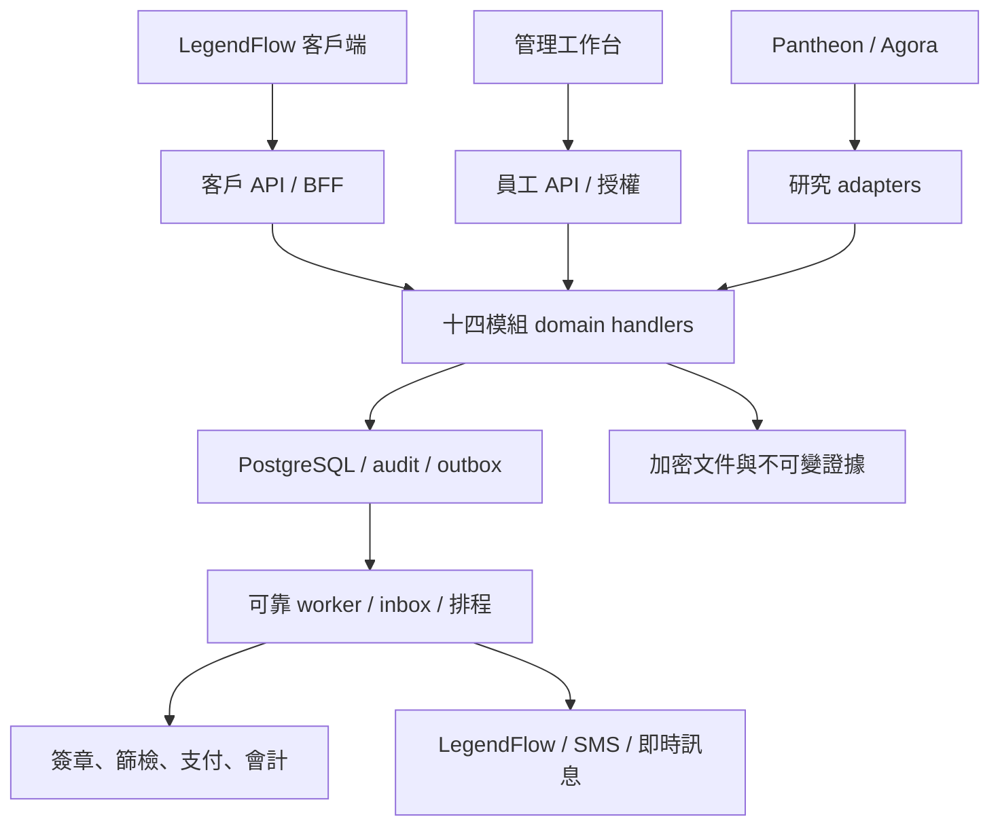

# 03｜系統設計 SD

## 1. 架構選擇

採 **模組化單體＋獨立可靠worker** 作為實作基線：Python3.12/FastAPI、PostgreSQL16、React/TypeScript內部管理端、S3相容加密物件儲存。這是為本案選定的技術基線，並非宣稱供應商既有技術。版本與相依套件鎖定由Build steward在首個實作PR確認。Redis可作短期快取/節流，但不能作唯一財務、命令或事件真實來源。

十四模組以獨立目錄、schema與domain ports分工，可同時實作與測試，不必變成十四個獨立部署的微服務才可平行。將來的獨立拆服務由負載、隔離與營運證據決定，保持相同versioned契約。

## 2. 執行單元與信任邊界

| 單元 | 輸入 | 可執行 | 禁止 |
|---|---|---|---|
| 客戶 BFF | 已驗session、最小範圍token | 自己的申請、表單、契約、已授權feed、客服 | 信任body的customer_id或tenant_id直接授權 |
| 員工 API | 公司IdP token、MFA/step-up proof | role+ABAC允許的command/query | 系統admin自動取得AML/簽章/支付權 |
| Webhook ingress | provider credential、驗簽原始body | 保存收件、schema驗證、dedupe、入inbox | 在HTTP request同步跑整串財務流程 |
| Worker | leased任務、service identity | 明確allowlist的決定性動作 | 冒充人員簽章或擴增未核准內容 |
| LLM gateway | 已脫敏且允許的context | 結構化draft與引用 | 接觸signature key、付款key、AML申報內容 |
| 物件存取服務 | 業務ID＋即時授權 | 短效下載、檔案校驗、retention | 永久公開URL、從客戶輸入直接讀任意bucket/path |
| Audit/export | 範圍與核准理由 | 可驗hash的最小證據包 | 包含整庫敏感資料的方便下載 |

## 3. 程式分層與目錄規約

每模組 `apps/api/src/modules/<slug>/` 分為 domain（狀態/規則）、application（commands/queries/use cases）、ports（外部及跨模組契約）、adapters（DB/provider）、http（typed DTO/router）。UI位於 `apps/admin/src/features/<slug>/`，worker位於 `workers/tasks/<slug>/`。不得從UI直接更新資料表。

共用程式只放tenant/auth context、command envelope、problem response、clock/UUID、audit/outbox、telemetry、文件reference等跨域機制，不能把所有業務規則移進巨型shared service。依賴注入使用真實或fake adapter；production啟動時拒絕fake provider配置。

## 4. 單一真實來源與寫入權

資料schema：core、customer、contract、kyc、aml、research、review、report、publication、delivery、crm、ownership、commission、support、finance。M02擁有entitlement與contract，M07擁有正式report和signature，M08擁有publication，M14擁有財會confirmed revenue；其他模組只讀明確projection或經port送命令。

一個API transaction從server建立tenant/actor context，檢查scope與業務condition，載入aggregate，檢查expected_version，寫state+audit+outbox+idempotency receipt後commit。跨模組同庫操作仍遵守domain handler，對需同時保證的契約承諾/權限條件以一致交易快照和鎖完成，不以快取舊gate決定。

## 5. 同步命令與非同步事件

命令HTTP傳Idempotency-Key；同tenant/actor/operation/key相同payload回放原result，異payload拒409。expected version/If-Match防止覆核與修訂互相覆蓋；過期回412，缺必要前提回428，validation回422，權限回403，外部不可用回503或回202附job狀態，不能回成功內容掩飾失敗。

交易性outbox與business commit同一Postgres transaction。publisher用lease/SKIP LOCKED取得待送事件，至少一次傳送；consumer以inbox唯一鍵去重，business mutation與applied receipt同交易。event_id、aggregate sequence、causal reference和payload hash不可變。broker有沒有採用均不改此保證；不得宣稱外部SMS/付款有端到端exactly-once。

外部callback先驗原始body簽章、timestamp/nonce/key ID與provider身份，再schema驗證、持久收件回應。遲到callback只按允許轉移更新，不能從refunded倒退成paid、從withdrawn倒退成published。回應丟失後重送同key；未知送達/付款先provider lookup與reconciliation。

## 6. 對簽章與發布的一致性設計

freeze的bundle manifest包含報告內容digest、引用snapshot、recommendation version、通路rendered text digest、audience rule版本、expiry與review refs。`content_hash`為簽署前明確canonical bytes的hash；`signed_file_hash`為provider簽完輸出檔hash，不混用。

簽章session保存challenge、signer authority snapshot、bundle版本、provider receipt與驗證結果。驗證通過後鎖report version、檢查尚未superseded/withdrawn、reviews全符合policy；同交易記錄signature evidence與 `report.signature_verified` outbox event；M08消費後建立publication job。publication consumer用(signature_id,bundle_version)唯一鍵避免重發。

名單快照保留publication時點的決策；dispatch必須重查當下contract/entitlement、restriction、channel binding與有效期限。重新查得不允許的收件人記suppressed，不能悄悄刪除原snapshot；不同snapshot可解釋誰當時入選而未實際發送。

## 7. 資料與檔案

tenant_id和UUID業務ID、cross-tenant composite FK、numeric金額、UTC timestamptz、version CAS與有效起訖是共同規範。API用decimal string，UI轉格式不能以float計帳。使用Asia/Taipei顯示及業務月結；資料以UTC存，半開期間 `[start,end)` 防止重算交界。金額結算的最小貨幣單位與四捨五入規則由已核准policy定義。

敏感文件先在quarantine上傳，掃毒/型態/長度/checksum通過才成為可引用object。object metadata有classification、owner、tenant、kms key reference、retention class與legal hold；事件只帶受控reference。簽章後版本不可修改，tombstone/撤回不刪歷史。

## 8. 授權與職責分離

RBAC決定粗scope，ABAC核對tenant、自己客戶/受派案件、資料類別、任職有效、專業登錄、maker-checker、record狀態。API與DB防禦雙層；RLS需要正確runtime角色及SET LOCAL context，不是有tenant_id欄位就安全。稽核readonly，維運僅技術metadata；委外測試用合成資料，production客戶/KYC/交易檔依公司既有控制承諾不得交給廠商。

AML資料使用獨立schema、role與加密政策，普通CRM只有必要operational gate。break-glass由公司內部指定人員核准且限時全紀錄；不能用它放寬委外廠商原本禁止的資料接觸。

## 9. 查詢、搜尋及工作清單

客戶360、漏斗、研究佇列與finance exception使用受限projection。Projection保存source sequence與as_of，更新失敗顯示stale而非空列表。敏感欄位不放一般全文索引。業務操作以原aggregate最新值重核，不以報表snapshot當授權。cursor pagination附穩定排序；export由async job產受控短效下載，不在HTTP一次拉整庫。

## 10. 排程與復原

排程有job identity、tenant、scheduled_at、lease、attempt、last_error、next_retry和dead letter。到期提醒、KYC刷新、Pool判定、收入認列與獎金月結每次依業務唯一鍵執行。避免用當前日期推估已執行，補跑用明確期間與dry-run差異。restored環境先停發外部訊息/退款，對帳outbox/inbox/provider狀態後再恢復。

## 11. 部署、NFR與觀測

dev/test/staging/prod分離配置和資料；完整版本由image digest＋migration head＋schema version＋policy version識別。dev mocks與stage真sandbox分開。Metrics覆蓋queue age、簽章到feed時間、過期建議重送阻擋、重複請求、對帳差異、收入/獎金不平、SLA逾期、RLS拒絕與audit缺口。詳細目標與壓測在 `14-nfr-observability.md`，部署/恢復在 `15-deployment-runbooks.md`。

## 12. ADR摘要

採modular monolith以降低十四人同時協作的部署負擔；用contract-first保證parallel；以transactional outbox/inbox與provider reconciliation處理外部不確定性；簽章包凍結避免簽後內容漂移；業務和計獎歸屬分開避免空指派領獎。正式ADR位於 `docs/adr/`，不把未選定供應商寫成已選定。
