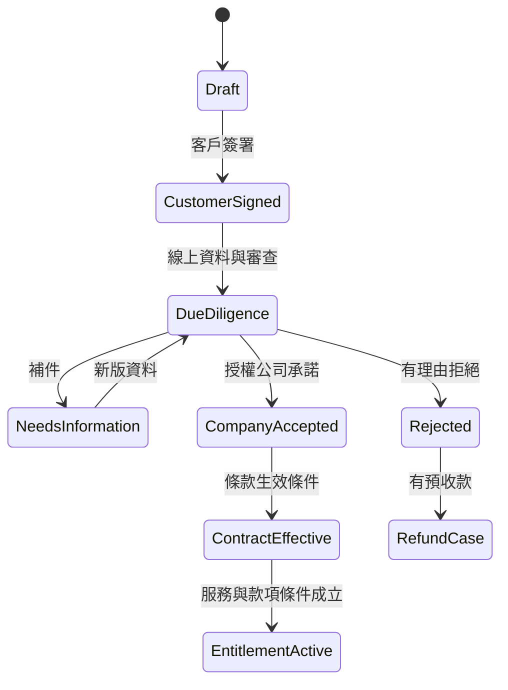
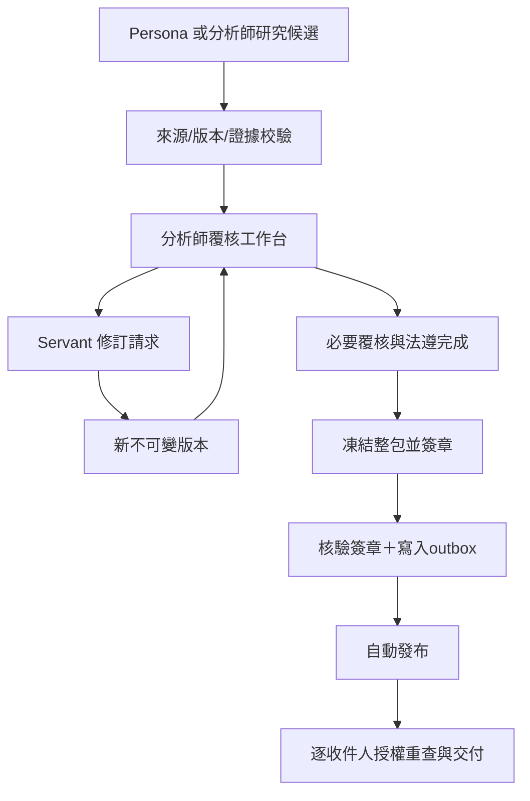

# 05｜狀態機、命令與例外恢復

API具體enum以OpenAPI/schema為可驗證契約；本文件描述業務語義與transition guard。資料庫枚舉/狀態check由Data steward對照契約同步，不允許UI自行推算下一狀態。

## 1. 申請與契約

圖為跨aggregate流程，不代表一欄status承載所有狀態。

| 命令 | Guard | 寫入與事件 | 異常處理 |
|---|---|---|---|
| 客戶簽署 | 當事人、有效文件版本、證據完整 | immutable signature envelope；signed timestamp | webhook重複回原結果；不同hash同session拒絕 |
| 提交審查 | 已完成所需欄位與安全附件 | 新submission version，排各domain review | 缺資料回needs_information，保存原輸入 |
| 公司承諾 | 最新KYC/適合度/AML gate合格、簽署未撤回、授權人有效 | acceptance snapshot、contract event | 輸入版更換拒412；限制/過期拒422 |
| 啟用服務 | contract有效、付款/履約條件、無限制 | 帶scope/period的entitlement | paid但未accepted保持locked |
| 終止/到期 | 生效條款和經核決理由 | 關閉該服務未來權限，啟退款/清算 | 多契約客戶其他權限獨立保留 |

付款可早於公司承諾。application、contract、payment、entitlement不得因UI需要一個進度條合併成單一欄位。

## 2. KYC、適合度與AML

KYC版本歷經草稿、提交、補件/審閱、通過/拒絕、刷新到期。適合度記錄問卷版本、原答案、計算結果、判斷與適用service scope，升級須符合新版範圍。AML篩檢命中只是case input；possible match、confirmed match、EDD與最終決策分開，第三方timeout不當作clear。各結論都有valid_until和revoked/superseded資訊。

company acceptance讀最新gate時持鎖；在公司承諾與權限啟用之間新增限制，要阻止啟用。服務期間refresh逾期或命中由核准政策決定限制，保留既有契約和通知紀錄，不倒刪歷史。

## 3. 研究與發布

| Transition | 必要條件 | 拒絕／恢復 |
|---|---|---|
| candidate→reviewable | schema/hash/tenant/授權、來源時點可解釋 | quarantine；同payload同key回原receipt，補正須新版本與key |
| review→revision_requested | 目前version、明確意圖、scope | Servanttimeout可重查job，不建立重複修訂 |
| revision→review | 新artifact校驗通過、lineage正確 | 舊review標stale；不把舊approval移植 |
| reviewed→signature_pending | 所有required reviews適用同bundle | 有review撤銷或資料過期則退回 |
| signature_pending→verified | exactdigest、有效signer、provider核驗 | unknown需查證；不以圖片或callback文字當簽章 |
| verified→publication_requested | 未撤回、有效期、review仍符policy | transaction rollback不遺失事件；復原可重放 |
| publication→dispatch | audience snapshot與最新eligibility | 不合格suppressed；expired不盲重送 |
| published→correction/withdrawal | 理由與權限、新內容依法完成覆核簽章 | 原紀錄保留；撤回可先暫停新增交付 |

## 4. 維護、Pool與轉換

原來源不隨業務調派變更。assignment有from/until/reason，客戶一時間只有一個有效主要維護歸屬；客服owner可以不同。離職事件按生效時間立即回company，未來轉換要新業務證據。已結算歷史不可轉給新人。

一般回Pool判定採待定案策略 BIZ-POOL-01：計算全部有效付費服務的coverage union；coverage連續中斷七天才eligible。有效年費服務尚在則月訂到期不觸發全客戶流失。法遵hold、客訴與退款不當普通再行銷線索。七天是業務期間定義，不是每週聯絡績效要求。定案前僅simulation；其他ownership/交接功能照常開發。

重新開發時先claim/assign，再記真實聯繫與客戶需求、opportunity、轉換。claim不計獎；成功續訂/升級才產conversion evidence。歸屬爭議獨立案，不能事後篡改接觸時間。

## 5. 財會與獎金

payment：建立→外部受理/成功/失敗/未知→settlement/bank reconciliation。refund：申請→計算→獨立覆核→送provider→確認/未知/失敗→會計調整→結案。未知先query，不能自動再退一次。

收入：service schedule→period recognition candidate→finance confirmation→locked period→linked adjustment。commission：eligible revenue→policy resolution→simulation→exception review→approved statement→export→paid confirmation；未核准policy止於simulation。退款調整回到原revenue與commission entry，記新負向entry，不修改既有核准帳。

## 6. 客服

新案→分類/分流→指派→處理→待客戶或內部→解決→結案/重開。等待原因、SLA暫停是否允許與計時版本明記；客訴/身分盜用/重大風險不能因客戶沒回覆自動關閉。轉給分析師/財會/AML是受控子任務或reference，不複製敏感case全文。

## 7. 一律適用的失敗語義

重複請求回相同結果；不同payload同key拒絕。舊version寫入拒絕並回目前version；外部不可用保存待辦和重試時點，UI不能顯示「已完成」。恢復重放先核對已發生的外部效果，避免重扣、重退、重發。所有人工override都記who/when/why/原值/新值與必要核准。
