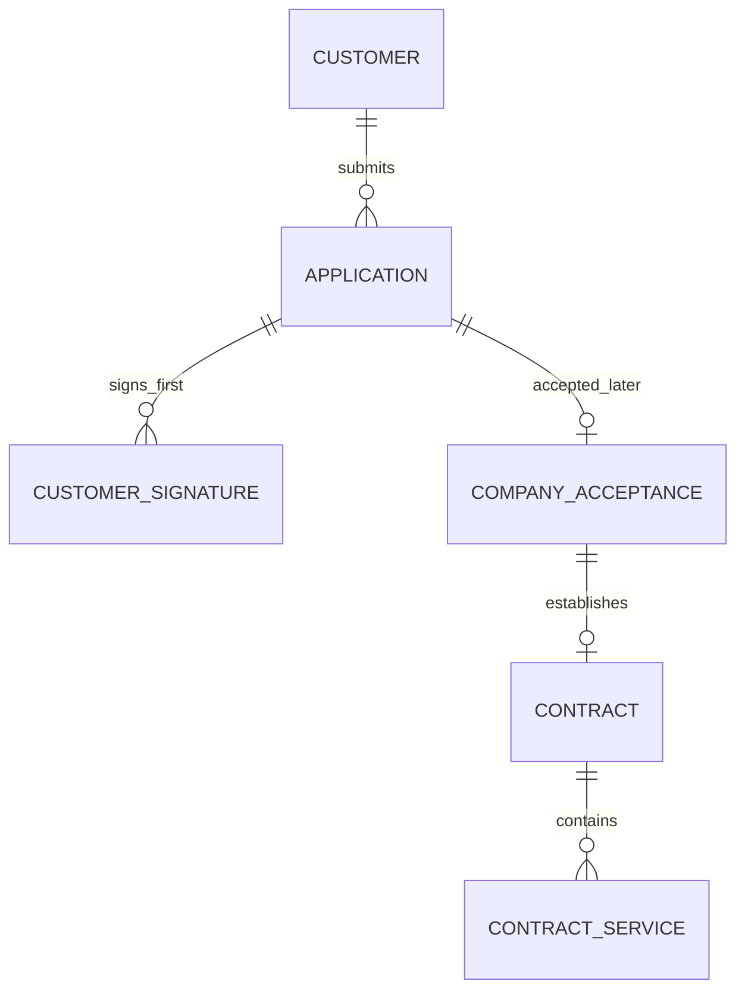
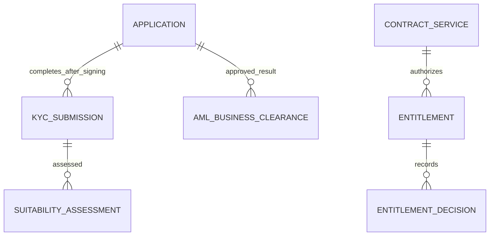
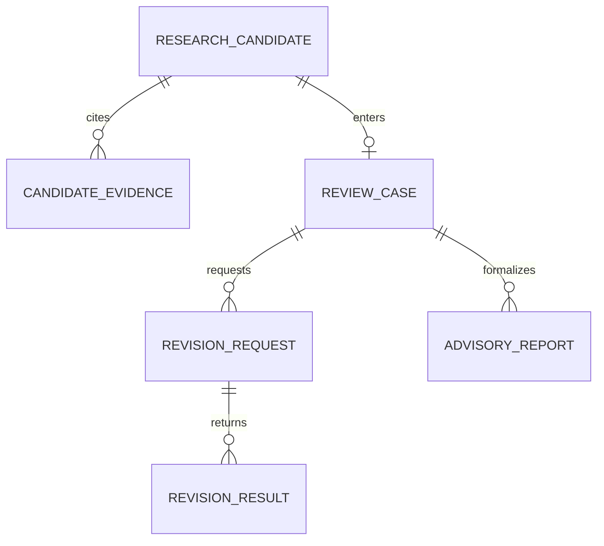
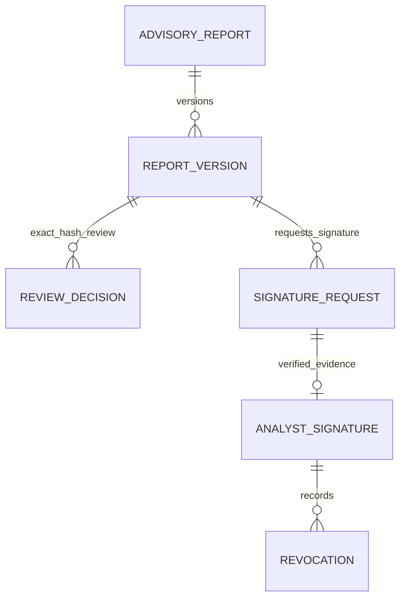
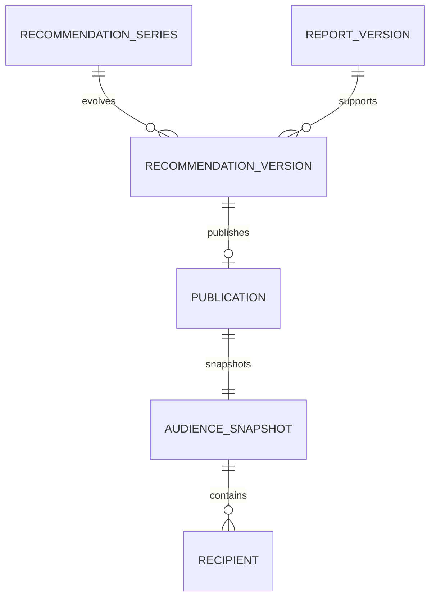
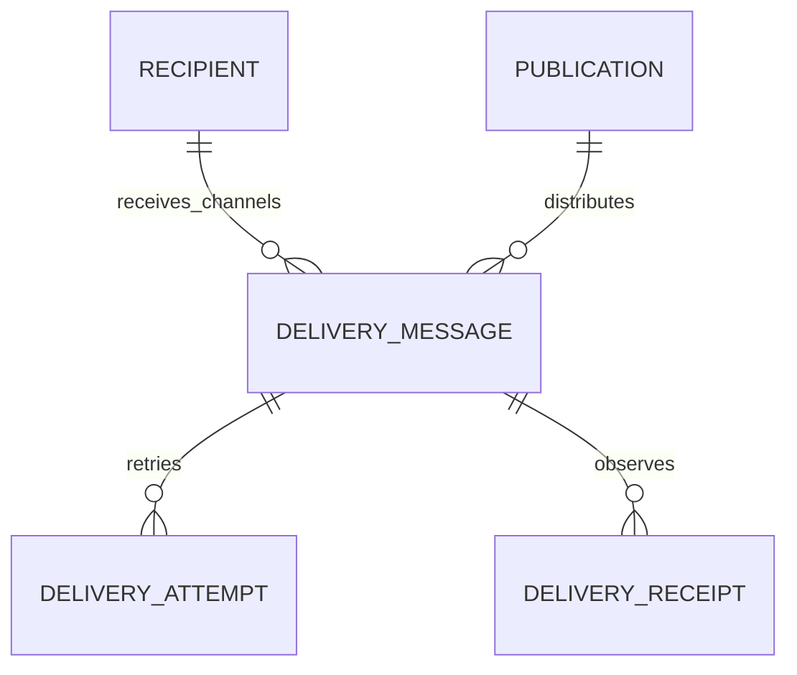
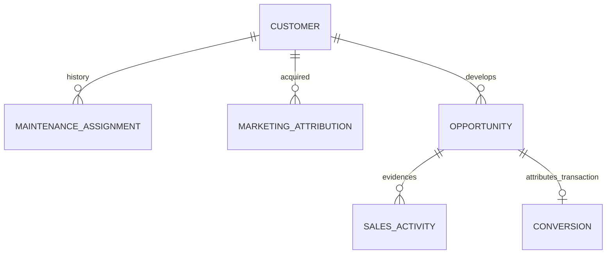
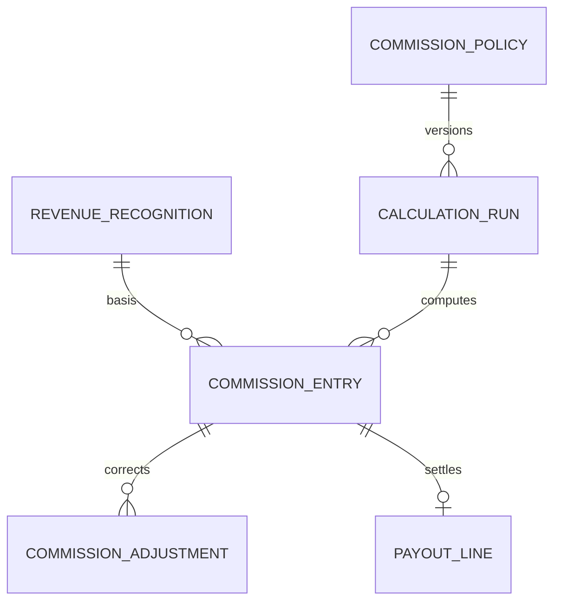
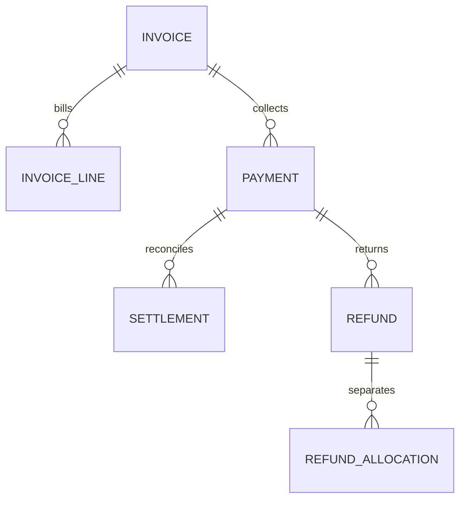

# SD：資料模型、ERD 與資料所有權

版本：1.0.0。適用範圍：十四個營運平台模組同時開發的共用資料契約。正式 DDL 位於 [database/migrations](../database/migrations)，欄位、型別、FK、PII 分類、保存類型與條件完整列於 [資料字典](../database/data-dictionary.md)；本文件說明關係與業務設計。

## 1. 資料庫與外部系統的責任

本平台 PostgreSQL 記錄公司對客戶及服務的正式營運事實。Pantheon 的 Persona、交易 pool、研究任務、策略／模型、研究證據仍由 Pantheon 管理；本平台保存它們的不可變引用與收到當時的必要快照。Agora/Servant 對話由外部提供，平台保存要求、修訂版本、產物與審核鏈。LegendFlow 負責客戶介面，正式契約、權限、報告發布和送達狀態由本平台的領域服務決定。

「來源系統最新內容」不能覆寫當年某次簽章或配送所使用的快照。查詢即時最新資料與稽核當時資料是不同的 query：前者可重取來源，後者必須用當次引用、時間、hash 與物件版本還原。

## 2. 十四模組寫入邊界

| 模組 | Schema | 主要權威資料 | 不得代寫的資料 |
|---|---|---|---|
| M01 客戶身分與申請 | `customer` | customer、external_identity、application、consent、merge_case | 公司接受、AML 結果、收款 |
| M02 契約及權益 | `contract` | package_version、customer_signature、acceptance_decision、company_acceptance、contract、contract_service、entitlement、entitlement_decision | 修改客戶 KYC 回答、偽造 payment |
| M03 KYC／適合度 | `kyc` | submission、submission_document、suitability_assessment | AML 清除、公司接受、獎金 |
| M04 AML/CFT | `aml` | screening、case_file、case_action、business_clearance | CRM 招攬名單、業務歸戶 |
| M05 研究候選接入 | `research` | candidate、candidate_evidence | 投顧正式發布、Persona 交易 |
| M06 分析師協作覆核 | `review` | case_file、conversation、revision_request、revision_result | 分析師簽章、簽後改稿 |
| M07 正式研究與簽章 | `report` | report、report_version、review_decision、signature_request、signature、revocation | 外部 Persona 交易狀態 |
| M08 建議／自動發布 | `publication` | recommendation_series/version、publication、audience_snapshot、recipient | 再生成簽後投資判斷、直接擴權 |
| M09 LegendFlow／配送 | `delivery` | channel_binding、message、attempt、receipt | 將 accepted 當 delivered、覆寫原訊息 |
| M10 CRM | `crm` | marketing_attribution、opportunity、activity、conversion、work_item、suppression | 修改已確認收入、自行批准獎金 |
| M11 維護歸屬／Pool | `ownership` | policy_version、assignment、pool_entry | 以單一維護人覆寫交易歸因 |
| M12 獎金 | `commission` | policy_version、calculation_run、entry、adjustment、payout_batch/line | 改收入、將試算直接付款 |
| M13 客服 | `support` | case_file、interaction、sla_event、response_draft、response_approval、response_dispatch、response_attempt、response_receipt | 更改業務 owner、讀受限 AML 調查 |
| M14 財會與內控 | `finance` | invoice/line、payment、settlement、reconciliation_item、service_schedule、revenue_run、revenue_recognition、refund/allocation、journal/line、accounting_export、control_exception | 用現金收款取代收入認列、事後刪證據 |

`core` 是共同基礎：tenant、actor、staff_credential、credential_revocation、object_asset、retention_policy、legal_hold、audit_event、outbox、inbox、idempotency_record、job_lease。共用基礎負責人維護這些 schema；每一模組以規定 port 寫入自己的業務表並在同一交易寫 audit/outbox。禁止為方便而讓十四個 agent 同時任意改同一 migration。

跨域 FK 確保引用存在且同 tenant；它不是允許跨域寫入。模組可依 read port 或已列明的 DB 只讀權限取得所需條件，寫操作仍發給權威模組。可把更新事件形成 Customer 360 讀取模型，但該投影不能成為 AML 或付款結果的第二套權威資料。

## 3. ERD：客戶與契約

`customer_signature` 固定客戶所見文件版本、content hash、signed-file hash、身份驗證等級、provider transaction、客戶簽署真實時點及證據。它可以先於 KYC。`company_acceptance` 另指向本次通過的 KYC、適合度及 AML safe clearance；日期不可先於這些審查證據。

`acceptance_decision` 先保存 accept／reject／request_changes 的全部公司決定，拒絕與補件亦有真實核定人、時點、理由及證據。只有 accept 另建 `company_acceptance`，與決策 ID 一對一關聯。M01 以 M02 事件更新 application 投影；M02 不直接寫 M01 主檔。申請還在草稿時已保存 `package_version_id`、多服務 `service_selections`、new／renewal／upgrade／reactivation 意圖及前一契約引用，不能等客戶簽完才知道他申辦什麼。

`contract` 的 `pending_company_acceptance → accepted → effective` 不與 customer signature、payment 或 entitlement 混用。`contract_service` 支援同客戶的多個服務及並行年度／月度契約，不是另外建立複雜套餐管理平台。每次交易保留服務條件快照、期間、實際未稅金額與 `service_chain_id`，讓續訂、升級、退款、獎金可沿著同一服務鏈追溯。

客戶身分合併用 `merge_case` 保留 source/target、提出人、覆核人、證據及狀態。customer 主檔保留 `merged_into_id`，外部身份連結需去重；歷史簽章、收入、配送與原客戶 ID 不因合併而被無痕覆寫。

## 4. ERD：Persona 候選、協作、正式報告

候選 `origin` 明確區分 `persona_autonomous` 與 `analyst_requested`。Persona 可以先完成自身研究／pool 作業再提供報告；分析師主要處理覆核與修訂。`source_occurred_at`、`received_at`、`produced_at`、`reviewed_at`、`signed_at` 各代表真實事件時間，不得把後來簽章倒填成 Persona 過去交易時點。

`revision_request.base_revision_no` 用來避免分析師對舊稿下指令後覆蓋新稿。`revision_result` 不可變，含輸入 request、外部 artifact、內容摘要與來源清單。新結果抵達時 M06 判定是否已 stale；需要重新比較或覆核，不自動取代當前簽署版本。

報告新版本建立時就計算 candidate `content_sha256` 與 `bundle_sha256`，並列出待核准的訊息版本、受眾規則版本、風險揭露與正文引用。每次 review 綁精確 hash。所有要求的覆核完成後 freeze 確認 hash 仍一致並鎖定內容；不是 freeze 當下才首次產生 manifest。凍結後改內容、訊息或規則須新版本與新覆核。

`signature_request` 儲存簽署挑戰和 provider 呼叫進度；驗簽成功才新增 immutable `signature`。API 所見 pending／verified／failed／revoked 是 request、signature、revocation 的讀取投影。簽章證據同時保留正文 hash、bundle hash、簽後容器 hash、分析師資格版本與驗簽證據。

驗簽成功由 M07 服務在同一 transaction 新增 `signature` 與 `core.outbox` 的 `report.signature_verified`；資料庫 deferred constraint 在 commit 時檢查，**該 trigger 本身不代替服務發出事件**。檢查包括 producer、schema version、classification、report aggregate、當次 aggregate version、signature/report IDs、正文／bundle／signed-file hashes、驗簽與有效期時間。worker 自動推進發布，不增加第二個人工 Publish 按鈕。重送 event 或 provider callback 不能重複建同一版本的簽章與發布。

## 5. ERD：建議與逐人配送

每個 entry／update／exit／correction 位於一個 `recommendation_series`；每版訊息連到當時有效的正式報告版本。同一份仍有效且可支持判斷的報告可供多個訊息使用，但每個要發布的訊息版本及 hash 都必須存在於所簽 manifest。重大新判斷不得只換一個 report link 就發布。

`message` 的唯一鍵是 publication＋recipient＋channel；所有 retries 使用同一邏輯消息 key。`attempt` 是每次呼叫，`receipt` 是 provider 回傳事件。accepted、sent、delivered 分別記錄；沒有閱讀回執時 `read_at=null`，不得把未知當未讀，也不得把未讀當高流失分數。

發布快照中的 entitlement version 是當時證據。送出時 M09 再查契約、權益、限制、撤回與有效期，寫 `last_authorized_at` 和 `checked_entitlement_version`。收到逾時或 unknown 時先 query provider；已到期的建議不重試送出。更正／撤回透過新版本或事件處理，原文與已送紀錄保存。

## 6. ERD：歸戶、CRM 與計獎

五個概念各自保存：最初行銷來源、當前維護人、商機負責人、單筆成交歸因人、獎金受領人。客服案件 owner 是第六個獨立概念。維護人變更不改寫既有 conversion 或 commission entry。

`assignment` 用半開時間區間 `[valid_from, valid_until)`；同一客戶不可重疊，現行 assignment 至多一筆。離職立即歸公司。使用者的「客戶斷掉一周」目前採待核定的 **全部付費服務中斷連續七天** 設定；`pool_entry` 保存本次完整服務查詢快照，不能把七天沒聯絡當作流失，也不能因月訂結束而忽略仍有效的年度契約。未核定 Pool 政策禁止自動執行服務中斷回收，仍可完成排程、模擬與政策版本功能。

`crm.activity` 只代表實際接觸事實。計獎須已核定的 `conversion` 把該行為連到成功續訂／升級交易。批次簡訊、LLM 自動產生的紀錄或單純分配 owner 不足以取得業務獎金。歸因爭議另走核定與更正，不能在月底任意覆寫歸戶欄位。

已決定的係數是第一年100%、第二年50%、第三年起合格連續自動續訂25%；業務介入續約的池分配為行銷30／業務70。獎金池率、係數與分配順序、服務鏈尾端規則尚需核定。`base_pool_rate=null` 不是 0%，也不是默認3%；未核准政策只能 `simulation`，live gate 拒絕。不能因軟體要完成就偷偷把業務提案當成已核准。

`entry` 固定 finance recognition、conversion、assignment snapshot、attribution、政策與計算快照。退款扣回只指向原 entry 與可計獎已認列收入的 refund allocation；沿用原政策與受益者，不把責任轉嫁新維護人。`adjustment` 形成帳務，不表示有權直接扣薪。`calculation_run` 分開 queued、calculating、calculated、review_pending、approved、rejected、exported、failed，保存 prepared_by／approved_by 與收入截止。計算完成還需要獨立覆核；`payout_line` 只能引用 approved／exported live run 的行銷／業務列，company retained 不是對外支出。

## 7. ERD：財會與客服內控

收款、銀行結算、服務履約與收入認列分開。客戶於公司接受前付款可形成暫收／預收；拒絕申請走受控退款，不能先當收入計獎。發票稅類由財會核准設定，不在 schema 寫死5%或任意除以1.02。

`service_schedule` 保存服務期間與財會認列政策，`revenue_run` 保存計算期間、截止、dry-run、manifest、例外、提出／覆核人及過帳狀態；`revenue_recognition` 是與已核准非 dry-run 批次相連的已確認收入事實。退款拆分 `earned_revenue`、`unearned_prepayment`、`tax`、`fee`；未履約預付款返還不得再次扣減早已不在計獎基礎內的收入。金流手續費另列，不由銀行淨入帳直接倒推未稅服務收入。

`journal` 與 `journal_line` 形成雙式分錄；approved／posted 憑證在 transaction commit 時須非零且借貸平衡，提出人不可自己覆核。過帳後不得修改本金或分錄明細，以新的 reversal／correction 憑證處理。`accounting_export` 保存確切檔案、hash、核准人、ERP 批號和 acknowledgement。

客服 `case_file` 統一 web／LINE／email／phone／onsite，`interaction` 存原文物件引用與實際時間，`sla_event` 保存暫停／恢復／超時／升級原因。申訴、退款及投資判斷問題進授權工作流；一般客服摘要不可包含 AML 申報與名單比對明細。`control_exception` 指向受控資源、負責人、獨立覆核人與補正證據。

客服真正對外回覆另有明確資料鏈：`response_draft → response_approval → response_dispatch → response_attempt/receipt`。草稿保存精確 hash、來源與模型／prompt 版本；核准綁相同 hash，人工覆核者必須為有效人員，低風險模板由已核准 policy service 取得授權。新的投資判斷不能繞過正式報告流程從客服發出。dispatch 固定本人 `channel_binding`、內容、核准 ID、有效期與 idempotency key；只有 provider 真正確認才更新 accepted／sent／delivered，未知閱讀留 null。單純記錄一筆 outbound interaction 不等於已送出。送出時仍須再次查核通路撤銷、客戶權益及報告引用；未知結果先查 provider，不盲目重送。

`channel_binding` 管理 web 會員、LINE、SMS、email 的核驗身分與服務通知意願；web binding 只能來自 LegendFlow 經驗證的會員 proof。實際地址加密，只對 UI 返回 masked destination。這些都是本平台 adapter 規格，不要求修改 Pantheon／LegendFlow 的外部專案。

## 8. 技術欄位與完整性

| 規則 | 資料庫落點 | 應用層責任 |
|---|---|---|
| 租戶隔離 | tenant composite PK/FK、FORCE RLS、NOLOGIN 模組 roles | 驗證 auth claims，可信任連線設定 tenant，不接受前端任意指定 |
| 併發修改 | version trigger、unique keys、FK、必要 advisory lock | `If-Match`/CAS、跨域 gate SERIALIZABLE、有限重試 |
| 不可變證據 | append-only trigger；凍結報告欄位不可改 | 新版本／補償事件，不硬刪歷史 |
| 實際時間 | timestamptz，多種事件時間分列 | 保存 provider 時間與接收時間，校時、拒絕倒填 |
| 金額正確 | numeric(20,6)、check、平衡分錄 | Decimal、批准稅類、舍入政策、累計退款防超額 |
| 可靠整合 | outbox/inbox/idempotency tables、唯一鍵 | 同交易寫入、重播 fingerprint、provider 查詢、DLQ 處理 |
| 歸因可重現 | attribution/conversion/policy/entry 快照 | 原政策沖回、解釋原因、爭議核定 |
| 保存與保全 | policy＋object version＋legal_hold | 明確起算事件、期限核定、保全不得刪、受控清理 |

SQL 只實作重要資料完整性，並非完整業務授權引擎。仍需應用驗收：客戶 session 身份、職務角色、有效資格、條件適合限制、名單名義同一性、付款條件真實性、訊息授權與時間、退款累計上限、獎金總分配守恆、provider 認證與雙連線競爭。不可用「表上有 foreign key」代替上述檢查。

## 9. 實作順序與提交契約

十四組工程任務可同時開始，均以這版 DDL／catalog、OpenAPI、event schema 建 mock 與 repository adapter。若欄位不足，在本模組 PR 提出 schema change，資料整合者將相容擴充合併為下一號 migration。禁止各自創建另一份 Customer／Report／Payment 權威表再事後人工對帳。

詳見 [migration 作業程序](../database/migration-operations.md)。驗證報告位於 [database/verification-report.json](../database/verification-report.json)，它記錄實際執行模式與版本。single-user PostgreSQL 無法驗證 runtime RLS，因此報告會明確標示未執行，完整隔離測試由一般 PostgreSQL server CI 執行。
