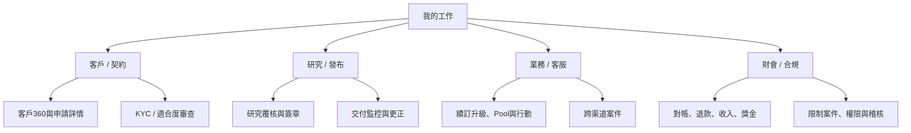

# 10｜管理平台 UI/UX 與前端交付規格

## 1. 導覽與資訊架構

管理介面依工作分為客戶契約、研究覆核、發布交付、CRM/維護、客服、財會獎金、合規稽核七個工作區；十四模組實作不等於十四套不一致的後台。首頁只呈現使用者可處理的工作、逾期例外與下一步，不用一堆沒有可執行動作的營收圖表取代營運。

全域頂列：公司/環境標記、權限內搜尋、通知、使用者與角色；左欄工作區；主區清單/詳情；右側可收起的證據/AI草稿區。客戶360共用摘要維持身分、有效服務、維護歸屬、開放案件與下一動作，敏感區依權限另取資料。

### 畫面層級

## 2. 共用互動規範

- 頁面先載概要與可操作權限，再以授權API載敏感分頁；不能只用CSS藏內容。
- 服務狀態、申請狀態、付款、審查與公司承諾分開顯示，避免單一綠勾誤導已開通。
- 表格預設顯示負責人、原因、下一步、期限與資料時點；filter/sort/cursor可分享但不含PII query。
- 所有決策按鈕由後端allowed actions/授權結果決定；不合資格標原因，禁止用前端改role解鎖。
- 保存/提交時鎖定同次request的idempotency key，回412顯示版本已更新、重新載入和diff，不自動覆蓋。
- 外部等待顯示job ID、pending/unknown與查詢重試；不可將loading轉成假成功。局部錯誤保留其餘可用資料。
- AI區以草稿、來源、模型執行時間與缺少資料標示；採用草稿只更新待送表單，仍經正式命令。
- 重大動作在同頁展示具體作用對象、金額/範圍、版本與後果供確認；日常可逆編輯不加多餘彈窗。
- 桌面1440px為主要布局，1024px可收左右欄，768px以下改卡片/單欄；小螢幕簽章仍須可檢閱整包，不能省略內容。
- 鍵盤可達、明確focus、文字對比與非顏色狀態、label/error關聯、讀屏live提示、可放大200%、日期含時區。

## 3. 畫面契約表

| Screen | 路由（內部UI） | 主要資料與布局 | 主動作／module |
|---|---|---|---|
| UI-01 | /work | 分派給我的待辦、SLA、待核決與錯誤 | 開啟case、領取可領工作／全域 |
| UI-02 | /customers | 客戶清單、來源、有效契約數、owner、案件 | 搜尋、範圍匯出／M01 |
| UI-03 | /customers/:id | 客戶360、契約/互動/服務分頁 | 更正白名單資料、開案／M01 |
| UI-04 | /applications | 已簽/待補件/待審查/待承諾列隊 | 指派、補件提醒／M01/M02 |
| UI-05 | /applications/:id | 簽署文件、獨立gates、付款、公司承諾 | 承諾/拒絕、有理由退回／M02 |
| UI-06 | /contracts/:id | exact文件、雙方紀錄、期間與權限列表 | 查交付、終止、條款變更申請／M02 |
| UI-07 | /kyc/:id | 原始答案/附件與系統檢查並排 | 補件、通過、拒絕／M03 |
| UI-08 | /suitability/:id | 問卷版本、評分、需求、服務範圍 | 記判斷、條件與有效期／M03 |
| UI-09 | /aml | 授權人可見的篩檢/EDD queue | 處理命中與升級／M04 |
| UI-10 | /aml/:id | 受限證據、名單版本、case timeline | 排除/限制、主管核決／M04 |
| UI-11 | /research/inbox | Persona、標的、候選版、資料鮮度、owner | 領取、拒收、開研究／M05 |
| UI-12 | /research/:id | 報告/來源左中、Servant協作右欄 | 補充證據、修訂請求／M06 |
| UI-13 | /research/:id/compare | 舊新內容與引用差異、review狀態 | 選新版本並重新覆核／M06/M07 |
| UI-14 | /reports/:id/review | 全報告、recommendation series、必要覆核 | approve/reject/revise／M07 |
| UI-15 | /reports/:id/sign | exact bundle預覽、通路文案、受眾/期限 | step-up簽章；完成即自動發布／M07/M08 |
| UI-16 | /publications | 簽章到發布狀態、受眾數、例外 | 查blocked原因與修復／M08 |
| UI-17 | /publications/:id | 版本、研究連結、受眾快照與交付 | 授權撤回、建立更正／M08 |
| UI-18 | /deliveries | 通路accepted/sent/delivered/read/unknown | 查外部結果、合規重試／M09 |
| UI-19 | /crm/worklists | 續訂/升級/留存/補件、理由與下一步 | 指派/記行動／M10 |
| UI-20 | /crm/opportunities/:id | 客戶需求、聯繫證據、適合度、轉換 | 記聯繫結果、申請歸因／M10 |
| UI-21 | /crm/funnel | cohort漏斗與來源成本/轉換 | 點到可處理名單／M10 |
| UI-22 | /ownership/pool | company歸屬、原因、可聯絡狀態 | claim與重新開發／M11 |
| UI-23 | /ownership/transfers | assignment timeline、離職/移交 | 核准交接、處理爭議／M11 |
| UI-24 | /commissions | period/policy、試算、差異、結算狀態 | simulate、送覆核／M12 |
| UI-25 | /commissions/:id | 逐筆收入/退款/歸因/係數/收受人 | 異議、批准、受控匯出／M12 |
| UI-26 | /support | 全渠道case、priority、owner、SLA | 分類、指派、升級／M13 |
| UI-27 | /support/:id | 原始對話與時間線、關聯契約/付款/研究 | 草稿、回覆、轉介、結案／M13 |
| UI-28 | /finance/reconciliation | PSP/銀行/應收三欄配對與差異 | 確認match、開差異案／M14 |
| UI-29 | /finance/refunds/:id | 原款/可退額/履約/稅/獎金影響 | maker送審、checker核准／M14 |
| UI-30 | /finance/revenue | 服務期間、預收、認列、調整與期末 | 確認/重算差異／M14 |
| UI-31 | /finance/close | 對帳、GL平衡、未決項、關帳 | 覆核關帳與匯出／M14 |
| UI-32 | /audit/evidence | 客戶/報告/交易的證據鏈manifest | 有範圍理由的匯出／M14 |
| UI-33 | /admin/access | 帳號/資格/roles/期限/申請 | 核准/撤銷權限／共用 |
| UI-34 | /operations/jobs | outbox/inbox、dead letters、provider health | 受控redrive／共用 |

UI路由是前端導覽設計，與HTTP API路徑不同；API呼叫以OpenAPI operationId為準。不得把UI路徑當供應商既有端點。

## 4. 六個高頻畫面的實作細節

### 客戶申請審查

左側為客戶已簽文件與簽署時點，中間四張gates卡（KYC、適合度、AML作業旗標、款項），右側timeline與當前owner。每卡可跳到授權可見的review。主按鈕「公司同意承接」僅最新結論齊備時可用；非AML角色只看到待專責審查，不揭露命中類型。客戶先簽的事實不會因後續補件消失。

### 研究覆核與Servant

主區為exact報告內容，引用可展開出來源/時點/授權摘要；右欄是與此candidate/revision綁定的對話。送修訂前顯示正在改哪一版；新結果回來以新版本chip提示，原文仍可比對。Analyst不用重新手打Persona已做好的研究；主要做審閱、對話修正與最後責任確認。

### 簽章與立即發布

簽署頁一次展示報告、每則建議、SMS/即時訊息文案、受眾服務範圍、有效期限與必要覆核。主按鈕用「簽章並自動發布」，文案說明簽章驗證成功即啟動交付；等待provider時顯示核驗中。完成後顯示feed發布與各通路狀態，不再出現另一個「正式發布」必按步驟。不能以rendered summary取代完整可查報告。

### 業務每日工作清單

以待維護目的分tab而非長篇客戶報表。每列給可解釋的「續約還差什麼」與一個下一動作；點入有客戶需求摘要、過往交談、服務狀態和合規抑制。行動表單填聯絡結果/客戶回應/next step，必要時引用對話，不讓「已聯絡」空勾直接觸發獎金。

### 客服一案到底

對話保留channel icon、原時間、驗身狀態，跨渠道加入同case前提示身分可信度。AI草稿可採用/修改/捨棄，投資內容導向已簽研究引用或分析師子任務；退款帶出原款和財會case，不讓客服自行輸入已退款結果。內部note與對客message分區和顏色/文字標示，避免誤送。

### 對帳與獎金

對帳左列原PSP，右列bank，中間差異與自動match理由；bulk apply只適用同一明確低風險規則，例外逐案。獎金詳情顯示收入→池rate→share→age factor→退款adjustment→payee，未核准參數顯示「試算」，不出現可直接付款按鈕。退款預覽同時呈現未履約與已認列影響。

## 5. LegendFlow 客戶端協作規格

LegendFlow實作既有網站頁面，平台提供API與狀態：signup/session linking→簽署文件→KYC/適合度/AML資料→待審查→公司承諾/契約副本→服務啟用→建議feed與報告連結→客服/終止申請。

客戶對外狀態使用一般語句：資料待補、審查中、未獲承接、付款處理中、已開通；不回內部疑似洗錢或篩檢詳情。所有頁面重載可續作，未登入或過期連結先驗身再導回原任務，不能把PII放URL。閱讀報告是可選查閱，不阻擋建議通知；法律文件必要簽署/交付證據另記。

## 6. Empty/loading/error/denied/stale

每個Screen都要覆蓋初始loading、空清單、局部provider unavailable、403/404、資料過期、version conflict、表單驗證、保存成功、操作pending、重送dedupe與取消。錯誤顯示可採取動作與correlation reference，不顯堆疊、SQL、token或完整敏感request。列表不得因後端故障顯示「目前沒有案件」。

## 7. UI驗收交付

各module交付可操作screen及元件測試，QA針對34個screen列出角色與狀態截圖/錄影；共用UI steward檢查keyboard、label、時間/金額格式、避免越權預載與無障礙。資料來自合成fixtures，不能將正式客戶錄影提交public PR。UI以 `allowed actions + version` 作資料契約，仍由API最終授權。
